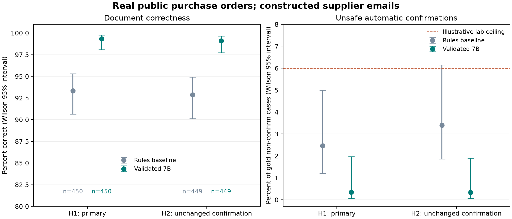

# Purchase-order confirmation: an evaluation lab with a release gate

Build a small extraction service, discover a real validation bug, and decide
whether the repaired candidate clears a frozen evaluation gate. The experiment
uses **2,160 real public purchase-order records and 2,152 synthetic supplier
emails**. It runs actual open-weight models on an owned GPU. The emails and
feedback tickets are constructed; the results are not production measurements.

The complete code, input facts, generated emails, audited labels, frozen
protocol, predictions and gate decisions are included. No API key is required
to replay the published results. Model weights and raw real-email text are not
distributed. Code is MIT; separate data/model terms are recorded in
[DATA.md](docs/DATA.md) and [MODELS.json](docs/MODELS.json).

## Start with the result replay

With Python3.12, from this directory:

```sh
python3 src/reproduce.py
```

This verifies the frozen input hashes, recomputes metrics and confidence
intervals, runs the gate on both held-out sets, and proves that five broken
systems are blocked while an artificial correctness oracle passes. It also
regenerates the feedback and deliberate test-contamination demonstrations.
A candidate BLOCK is a scientific result; replay success does not force a
candidate to pass. The command refuses missing prediction rows.

Focused safety checks, without any model server:

```sh
python3 -m unittest discover -s tests -v
```

For new inference, first serve the exact7B GGUF files listed in MODELS.json with
llama.cpp build12242, commit3b4d6ab3f. The recorded setup uses four parallel
slots and16,384 total context tokens (4,096 per slot), on one RTX3090. Use
localhost or an SSH tunnel to an owned host; do not expose an unauthenticated
model server to a public network. Verify downloaded weight hashes against the
model metadata. The original operational file-hash receipt is in
[RUNTIME_ATTESTATION.json](docs/RUNTIME_ATTESTATION.json).

```sh
export LABE_SERVER_URL=http://127.0.0.1:8081
export LABE_MODEL_TAG=qwen2.5-7b-instruct-q4_k_m
python3 src/reproduce.py --infer
```

Existing complete shards resume without duplicate items. To perform independent
fresh inference, use a separate copy of the frozen source/data with an empty
`runs/` and `llm-io/` directory. Do not change the frozen artifacts. HTTP server
properties do not cryptographically attest the loaded weights; reproducing the
experiment still requires verifying the actual files on your owned host.

## What the program actually decides

The extractor sees the email text, not the ERP answer. It produces an order
identifier, intent, line quantities and prices, shipping date and conditions.
A separate deterministic policy compares those claims with the real PO.
Matching terms can confirm; supplier refusal can reject; uncertainty, changed
terms and missing information need a human. There are no ERP writes here.

The final candidate first removes quoted buyer messages, then extracts JSON,
checks numeric/date grounding and schema, retries once with a precise error,
and abstains if validation still fails. The source explicitly rejects nonfinite
numbers and extra lines. The decision policy and tolerance choices are part of
the lab specification, not a claim about any real procurement business.

## Development: what failed and why it changed

All figures in this table are **development-only**, on595 examples:

| System | Document correctness | Unsafe auto-confirms | Decision |
|---|---:|---:|---|
| Regex rules |91.26%|8 of370 non-confirm cases|Baseline|
|7B zero-shot |98.15%|8 of370|Quoted buyer details could be mistaken for supplier agreement|
|7B validation, before repair |96.97%|0 of370|BLOCK: refusal slice regressed|
|3B retrieved examples |93.28%|17 of370|BLOCK: unsafe-confirm upper bound7.23%, plus slice regressions|
|7B validation, repaired |99.50%|0 of370|Passes the fixed development gate|

The subtle bug was in our validator. A supplier can refuse an order while
describing its items without quantities or prices. We incorrectly required
those absent numbers, retried a correct extraction, then discarded it. The
refusal slice fell to72%. A focused test failed first; a class-dependent
validation fix restored that slice without inventing missing terms. Replaying
cached model output made the effect of the code repair directly inspectable.

The final candidate was chosen on these development cases, then frozen. H1 and
H2 were not used to choose this repair. This is prompt/validation development,
not model-weight fine-tuning. The3B comparison also changes prompting and model
size together; it does not isolate a causal effect of model size alone.

## Held-out methodology

[PREREG.md](docs/PREREG.md) fixes the candidate, metrics, sample sizes and bars
before inference. H1 contains450 emails; H2 contains449 different PO records.
The primary comparison is repaired7B versus rules, with H2 as an unchanged
confirmation. Supplier overlap means this is not an unseen-vendor test.

Accuracy differences use10,000 paired item-bootstrap draws. An additional2,000
supplier-cluster draws preserve dependence among orders from the same supplier.
The gate uses the more conservative lower bound. Proportions have Wilson95%
intervals. Zero unsafe confirmations does not establish zero future risk.
Behavior slices are engineering tripwires, not simultaneous subgroup inference.

The research gate checks complete coverage, sample size, unsafe-confirm upper
bound, parse failures, non-inferiority, automation recall and slice regression.
Always-human cannot pass by avoiding all risky work. Its6% safety ceiling is
an illustrative lab threshold, **not** authorization for autonomous purchasing.

The unchanged final experiment produced:

| Held-out set | Rules correctness | Validated7B correctness | Paired accuracy gain | Unsafe confirmations, final |
|---|---:|---:|---:|---:|
|H1,450 cases|93.33%|99.33% (95% CI98.06–99.77%)|+6.00pp (95% CI3.78–8.44)|1 of284; upper95% bound1.97%|
|H2,449 cases|92.87%|99.11% (95% CI97.73–99.65%)|+6.24pp (95% CI4.01–8.69)|1 of294; upper95% bound1.90%|

Supplier-cluster sensitivity intervals for the gains were3.71–8.29pp
(272 suppliers) and3.66–9.27pp (271 suppliers), respectively. Both frozen
research gates passed. All five deliberately broken systems were blocked;
the constructed oracle passed. Feedback359 produced two new regression cases,
expanding the development suite from595 to597. These are simulated support
cases, not observed customer reports.



**The passing gate did not erase two safety gaps.** In H1 the model omitted a
stated late shipping date; a policy which allows missing dates then confirmed
the order. In H2 it named a substituted item without flagging a condition;
the policy checked price/quantity but did not independently verify item
identity. These are acceptance defects for any proposed autonomous purchasing
use. No purchases or ERP writes occurred. They remain in
`results/error-analysis.json`, without tuning or refreezing against the test.
A future experiment should check extraction coverage and explicit item
identifiers, conservatively escalate ambiguity, and use fresh held-out data
after development. Those proposed repairs are **not tested improvements** here.

Final machine-readable results are in `results/h1-metrics.json`,
`results/h2-metrics.json`, `results/h1-gate.json`, `results/h2-gate.json`, and
`results/reproduction.json`. [RUNLOG.md](docs/RUNLOG.md) explains exact commands,
decisions, failed approaches and the distinction between observations and claims.

## Data and label limits

The emails were written from controlled supplier-behavior specifications over
real public PO lines. They are not customer emails. Independent model extraction
audited1,109 construction labels; the original records and two disagreements are
retained. [LABEL_AUDIT.md](docs/LABEL_AUDIT.md) distinguishes original agreement
from a later deterministic-policy recomputation. Model agreement does not prove
that construction labels match a real business's policy.

A partially annotated48-item real-email slice was recovered. It was not a
representative supplier/ERP-pair dataset and does not count toward the held-out
sample sizes. Its source text remains unpublished. A frontier extraction
reference was not completed after a subscription limit; no scores were filled in.

The feedback experiment uses359 separately constructed cases and simulated
support reports. Its actual discovered errors become durable regression
fixtures. The leakage demo intentionally memorizes H1 answers and then fails to
gain anything on the untouched H2. Neither demonstrates a production deployment.
GPU call latencies include shared-queue contention and are descriptive; there
is no serving-capacity, commercial-cost or business-outcome claim.

## Next steps for a real organization

Replace constructed emails with consented, de-identified, ERP-matched examples
and independently adjudicated labels. Split by thread, supplier and time as the
deployment question requires. Have operations owners specify tolerances and
the cost of false confirmations. Recompute sample sizes for those risk limits.
Then use shadow traffic, operator review and a small monitored rollout with a
real rollback path. None of those deployment steps were run in this lab.
